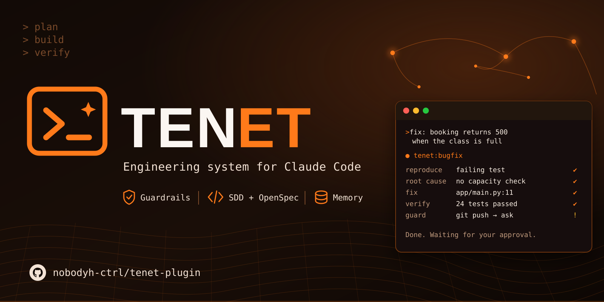
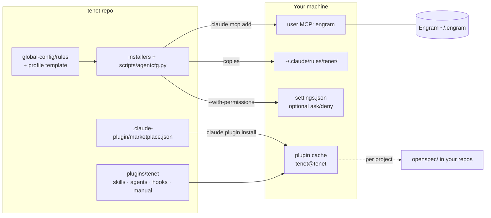

<p align="center">
  
</p>

# tenet

> **Beta: `0.1.0-beta.1`.** Ready to try; details may change before 1.0. See the [release notes](docs/releases/v0.1.0-beta.1.md). Check your installed version with `/tenet:version`.

**An engineering system for anyone who builds software with Claude Code.** It packages reusable skills, least-privilege agents, a safety guard hook, persistent memory through Engram, and spec-driven development with OpenSpec as the `tenet` plugin, with installers for Windows and Linux.

tenet shapes *how* Claude Code works in any repository. It does not decide *what* your product is. Each project keeps its own requirements, stack and decisions, and each person keeps a private profile (language, experience, learning goals) that never leaves their machine.

## How it works day to day

**You install once, then you just talk to Claude Code.** You never need to memorize tenet commands.

| Part | When it runs | What you do |
|---|---|---|
| Methodology rules and your profile | Loaded in every session | Nothing |
| Guard hook | Checks every command and file access | Nothing. It asks you before risky actions |
| Skills (feature, bugfix, study-topic...) | Claude picks the one that matches your request | Describe what you want |
| Agents (explorer, reviewer...) | Claude delegates to them when it is worth it | Nothing |
| Inner commands (git, tests, `openspec`) | Claude runs them, asking permission as usual | Approve or decline |

```text
You:    Booking returns a 500 when the class is full. Fix it.
Claude: (follows the bugfix workflow) reproduces it with a failing test, finds the root
        cause, applies a minimal fix, runs the suite, and asks before committing.

You:    I want to understand how AWS subnets work.
Claude: (switches to learning mode) checks what you know, explains in stages,
        and proposes a hands-on lab.
```

Slash commands like `/tenet:feature` are **optional shortcuts**. Claude usually picks the right workflow from your words, but that choice is a judgment, not a guarantee. Use the slash command when you want a specific process, for example the full spec-driven cycle.

The installer, `scripts/validate.py` and the tests are for installing and maintaining tenet, not for daily use.

## What you get

| Component | What it does |
|---|---|
| **Engineering workflows** | `/tenet:feature`, `/tenet:bugfix`, `/tenet:release`, `/tenet:project-init`, plus `plan-work`, `implement`, `review-code`, `verify-changes`, `documentation`, `devops-iac` |
| **Learning workflows** | `/tenet:study-topic`, `learn-concept`, `hands-on-lab`, `research-technology`, `aws-security`, `networking-lab`. Staged explanations with comprehension checkpoints and progress tracking |
| **Agents** | `explorer`, `architect`, `implementer`, `reviewer`, `security-reviewer`, `tutor`. Each gets the minimum tools it needs |
| **Guard hook** | Blocks clearly destructive commands, asks before risky ones (push, deploy, IaC apply, global installs), protects secret files, and keeps reviewer agents read-only |
| **Methodology rules** | Short user-level rules covering source of truth, SDD, memory, delegation, token efficiency and autonomy limits. Loaded in every session (~60 lines) |
| **Engineering Manual** | Standards and decision frameworks (MUST/SHOULD/EXPERIMENTAL), loaded on demand by skills. Includes technology and tool catalogs |
| **Installer** | PowerShell and Bash, with dry-run, backups, an ownership manifest, idempotency, selective uninstall and restore |

## Architecture



There is exactly one owner per surface, and no tool writes another tool's files. See [docs/architecture.md](docs/architecture.md) and [docs/configuration.md](docs/configuration.md).

## Requirements

- Claude Code 2.1+
- Python 3.9+
- bash (Git Bash on Windows) for the guard hook
- Optional: [Engram](https://github.com/Gentleman-Programming/engram) 3.4+ for memory, and [OpenSpec](https://openspec.dev) 1.14+ for spec-driven projects.

## Install

**Windows (PowerShell):**

```powershell
git clone https://github.com/nobodyh-ctrl/tenet-plugin
cd tenet-plugin
.\installers\install.ps1 -DryRun -WithPlugin -WithEngram   # preview
.\installers\install.ps1 -WithPlugin -WithEngram
```

**Linux:**

```bash
git clone https://github.com/nobodyh-ctrl/tenet-plugin
cd tenet-plugin
installers/install.sh --dry-run --with-plugin --with-engram   # preview
installers/install.sh --with-plugin --with-engram
```

**Plugin only, no clone:**

```bash
claude plugin marketplace add nobodyh-ctrl/tenet-plugin
claude plugin install tenet@tenet
```

After installing, edit your private profile at `~/.claude/rules/tenet/profile.md`. Full details are in [docs/installation.md](docs/installation.md).

## Using it

### Start a new app

```text
/tenet:project-init Booking API for a small gym: members reserve classes, admins manage schedules
```

tenet inspects the repository and asks only what it cannot infer: data sensitivity, scale, budget and deployment target. It then compares architecture options against the Engineering Manual and proposes `AGENTS.md`, ADRs and `.engram/config.json`. It also offers `openspec init`. **Nothing is written until you approve the file list.**

### Build a feature with SDD + OpenSpec

```text
/tenet:feature Members can cancel a reservation up to 2 hours before class
```

1. **Explore.** The main session reads the code, specs and memory. It sends an `explorer` only if the area is large.
2. **Propose.** `/opsx:propose` writes `openspec/changes/cancel-reservation/`:
   - `proposal.md` explains why the change exists;
   - `specs/` holds the requirements with WHEN/THEN scenarios;
   - `design.md` records the decisions;
   - `tasks.md` lists the steps, each with its verification.
3. **Review and approve.** You read the proposal and say yes, or ask for changes. Creating a proposal is never approval.
4. **Apply.** `/opsx:apply` works through the tasks, test first. A task is ticked only with evidence.
5. **Verify.** `/tenet:verify-changes` runs tests, lint and build, and checks every scenario has a passing check. It reports passed, failed, not executed or blocked for each one.
6. **Review.** `/tenet:review-code` runs, plus an independent `reviewer` or `security-reviewer` for risky changes.
7. **Archive.** After your approval, `/opsx:archive` merges the spec deltas into `openspec/specs/`. This is the living description of what the system does.

Small, contained tasks skip the ceremony. If a task could be resumed from your request plus `git diff`, it runs inline with a short plan.

### Fix a bug

```text
/tenet:bugfix POST /reservations returns 500 when the class is full
```

The workflow reproduces the bug with a failing test, finds the root cause with evidence, applies a minimal fix, runs the full suite, and saves the root cause to memory.

### Learn while building

```text
/tenet:study-topic VPC subnets and route tables
```

The tutor starts with a short diagnostic, explains in stages, checks your understanding between stages (you can say "skip checks"), and proposes a lab with cleanup and a cost estimate. Your gaps are recorded for the next session.

### Agents

The main session is the orchestrator. Subagents are used only with a named reason, such as broad exploration, independent review of a risky change, or disjoint parallel edits. They never push, deploy, apply infrastructure or write memory.

| Agent | Tools | Use |
|---|---|---|
| explorer | Read, Grep, Glob | `path:line` map of an area |
| architect | read + web | Options, trade-offs and a recommendation for `design.md` |
| implementer | read + Edit, Write, Bash | One bounded task on files nothing else is touching |
| reviewer | read + Bash (read-only, enforced by the hook) | Independent correctness review |
| security-reviewer | read + Bash (read-only, enforced by the hook) | Threat-focused review |
| tutor | read + web | Explanations and exercises |

## Memory (Engram)

With `--with-engram`, Claude Code gets Engram's `mem_*` tools. The methodology tells agents to:
- recall targeted context at the start of meaningful work;
- save decisions, root causes and lessons as they happen;
- write a session summary at handoff.

Memory never overrides code, tests or specs, and secrets are never saved.

## Security

The guard hook is a technical control. The rules are guidance. The hook stops accidents; it is **not** a sandbox. See [docs/security.md](docs/security.md) and [SECURITY.md](SECURITY.md).

## Update and uninstall

```bash
git pull && claude plugin marketplace update tenet && claude plugin update tenet@tenet
installers/install.sh                      # refresh the rules
installers/uninstall.sh --dry-run          # preview removal; your profile and foreign config are kept
```

## Documentation

- [Installation](docs/installation.md)
- [Configuration layers](docs/configuration.md)
- [Architecture](docs/architecture.md)
- [Security](docs/security.md)
- [Development](docs/development.md)
- [Troubleshooting](docs/troubleshooting.md)
- [Engineering Manual](plugins/tenet/manual/README.md)
- [Contributing](CONTRIBUTING.md)
- [Changelog](CHANGELOG.md)

## License

[MIT](LICENSE). You may use, modify and redistribute this project, including commercially, as long as the copyright notice is kept. It comes with no warranty.
