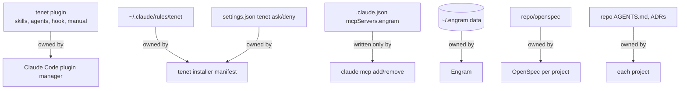

# Architecture

## Goals

- Smallest coherent system: methodology, memory, workflows and verification for Claude Code, with no second orchestration layer.
- One owner per configuration surface, and one source of truth per instruction.
- Small always-loaded context (~60 lines of rules). Everything else loads on demand.
- Technical enforcement where the platform allows it, with honest documentation where it does not.

## Components and responsibilities

| Component | Location | Responsibility |
|---|---|---|
| Marketplace | `.claude-plugin/marketplace.json` | Lists the `tenet` plugin for native installation |
| Skills | `plugins/tenet/skills/` | Procedures: engineering, workflows, learning. Loaded when invoked or relevant |
| Agents | `plugins/tenet/agents/` | Least-privilege subagents with fixed output contracts |
| Guard hook | `plugins/tenet/hooks/` | `PreToolUse` policy engine. Rules are data in `policy.json` |
| Engineering Manual | `plugins/tenet/manual/` | Standards and catalogs. Skills reference it via `${CLAUDE_PLUGIN_ROOT}` |
| Methodology rules | `global-config/rules/` → `~/.claude/rules/tenet/` | Always-on behavior. Plugins cannot ship this |
| Installer | `installers/` + `scripts/agentcfg.py` | Rules, profile, optional permissions and CLI registrations, tracked in a manifest |
| Validation | `scripts/validate.py`, `tests/`, CI | Structure, content contracts, secrets, behavior |
| Specs | `openspec/` | This repository is itself developed with OpenSpec |

## Ownership

## Request flow

1. A session starts. Claude Code loads the user rules (methodology and profile) and the plugin's skill and agent descriptions.
2. The user invokes a workflow, such as `/tenet:feature`, or Claude picks a skill that matches the request.
3. The skill reads only the manual sections and specs it needs, and queries Engram with targeted searches.
4. Every tool call passes through the guard hook first: deny, ask, or no decision.
5. Subagents run only with a named reason. Their Bash calls go through the same hook, and reviewers are held to read-only.
6. Verification evidence is produced, memory is updated, and the user approves before archive, push or deploy.

## Key decisions

| Decision | Choice | Rejected alternative |
|---|---|---|
| Distribution | Native plugin + marketplace | Copying files into `~/.claude` (no updates, no namespacing) |
| Always-on methodology | `~/.claude/rules/<tool>/` | A block in `~/.claude/CLAUDE.md` (shared file, unsafe uninstall) |
| Agent configuration framework | None; native Claude Code | Gentle AI 4.x: an isolated test showed it imposes its ODD workflow, automatic commits and ~80 KB of always-on instructions |
| Memory wiring | `claude mcp add` (MCP only) | Engram plugin hooks (needs `jq`, adds third-party hooks); Gentle AI |
| Installer logic | Python core + PowerShell/Bash wrappers | Duplicate logic in two shells |
| Guard implementation | Python + policy data, launched by bash | Pure bash (fragile JSON parsing) |
| Code graph tools | Deferred (catalog) | Installing several MCP graph servers up front |

The full design, with rationale, is in [the archived change](../openspec/changes/archive/2026-10-14-establish-forge-system/design.md). Current behavior is specified in [openspec/specs/](../openspec/specs/).
